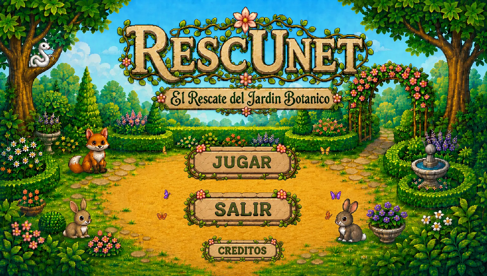
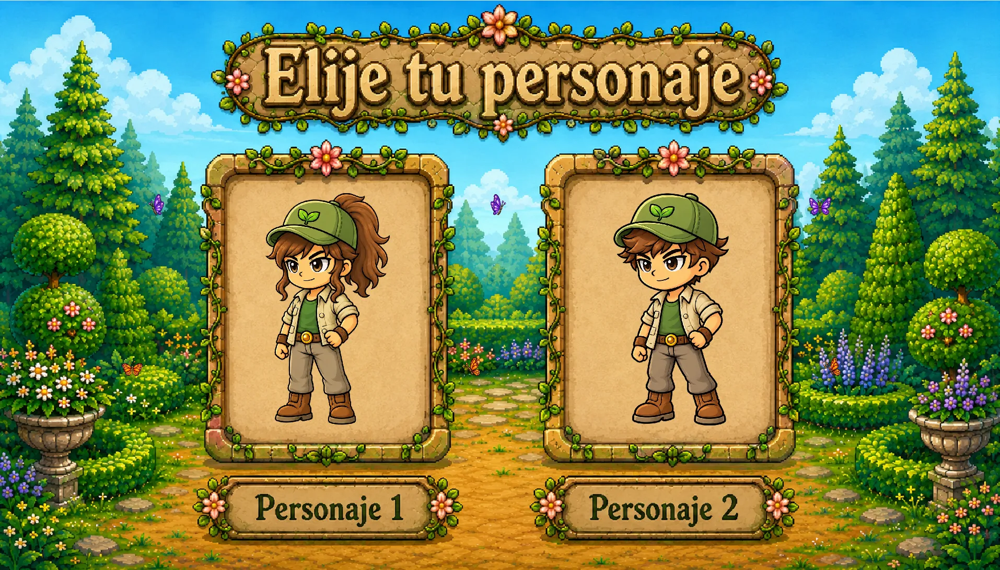
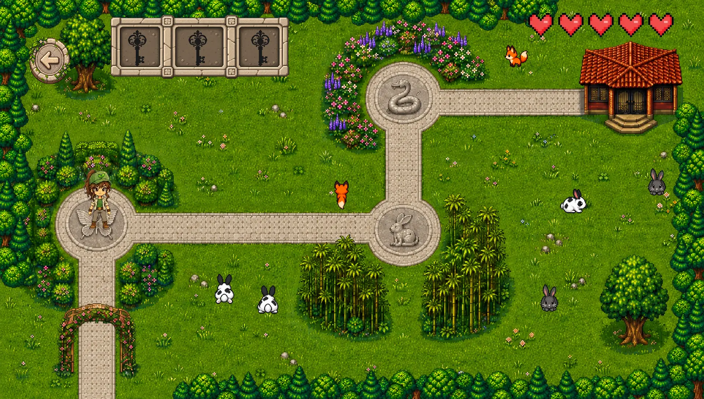
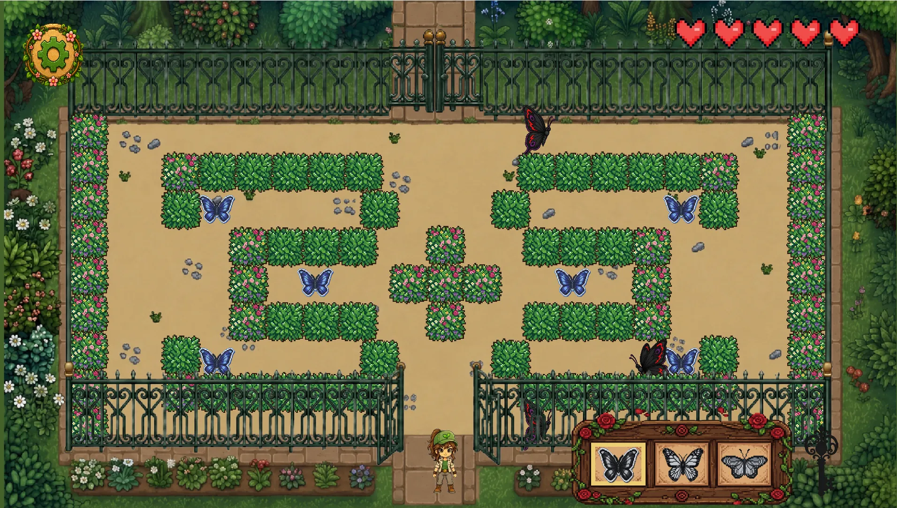
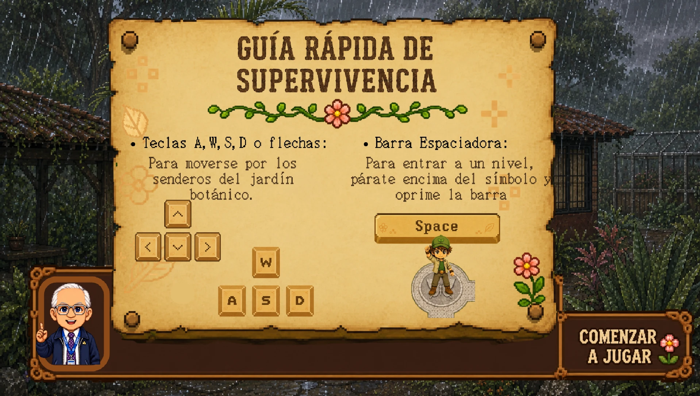

# RescUnet: El Rescate del Jardín Botánico

<p align="center">
  
  
</p>
<p align="center">
  
  
</p>
<p align="center">
  
</p>

Español | [English](#english)

Este juego fue mi proyecto final de **Programación I** en la Universidad Nacional Experimental del Táchira (UNET), hecho en Java con libGDX.

Fue la primera vez que armamos algo grande desde cero: pensar la historia, dibujar el flujo de pantallas, repartir el trabajo, juntar el código de las dos y resolver los conflictos de Git cuando chocaba. Aprendimos programación orientada a objetos de verdad, porque cada personaje, enemigo, objeto y mapa es una clase con su propia responsabilidad.

## De qué trata

El jardín botánico de la UNET está en peligro y te toca rescatarlo. Eliges a tu personaje, recorres los senderos del jardín y entras a cada zona parándote sobre su estatua.

- **Tres niveles:** mariposas, conejos y flores. En cada uno los recoges en el orden de colores que marca el panel de abajo.
- **Enemigos:** si te tocan pierdes un corazón. Tienes cinco.
- **Llaves:** al terminar cada nivel ganas una llave. Con las tres llegas al invernadero y al final de la historia.
- **Extras:** guía de controles, avisos antes de cada nivel, música, pantalla de game over y créditos.

## Controles

- **W, A, S, D o flechas:** moverse.
- **Barra espaciadora:** entrar a un nivel parado encima de su símbolo.

## Tecnología

Java 21, libGDX 1.14 y LWJGL3 para la versión de escritorio, con Gradle para compilar.

## Cómo jugarlo

Necesitas Java 21 o superior. Desde la carpeta del proyecto:

```bash
./gradlew lwjgl3:run
```

En Windows usa `gradlew.bat lwjgl3:run`.

---

## English

This game was our final project for **Programming I** at the Universidad Nacional Experimental del Táchira (UNET), built in Java with libGDX. Maria de los Angeles Marquez and I made it as a team.

It was the first time we built something big from scratch: writing the story, drawing the screen flow, splitting the work, merging both of our code and fixing Git conflicts when they came up. We really learned object oriented programming, because every character, enemy, item and map is a class with its own responsibility.

### What it is about

The UNET botanical garden is in danger and it is up to you to rescue it. You choose your character, walk the garden paths and enter each area by standing on its statue.

- **Three levels:** butterflies, rabbits and flowers. In each one you collect them in the color order shown in the panel at the bottom.
- **Enemies:** if they touch you, you lose a heart. You have five.
- **Keys:** finishing each level gives you a key. With all three you reach the greenhouse and the end of the story.
- **Extras:** controls guide, notices before each level, music, game over screen and credits.

### Controls

- **W, A, S, D or arrow keys:** move.
- **Space bar:** enter a level while standing on its symbol.

### Tech stack

Java 21, libGDX 1.14 and LWJGL3 for the desktop version, built with Gradle.

### How to play

You need Java 21 or later. From the project folder:

```bash
./gradlew lwjgl3:run
```

On Windows use `gradlew.bat lwjgl3:run`.
